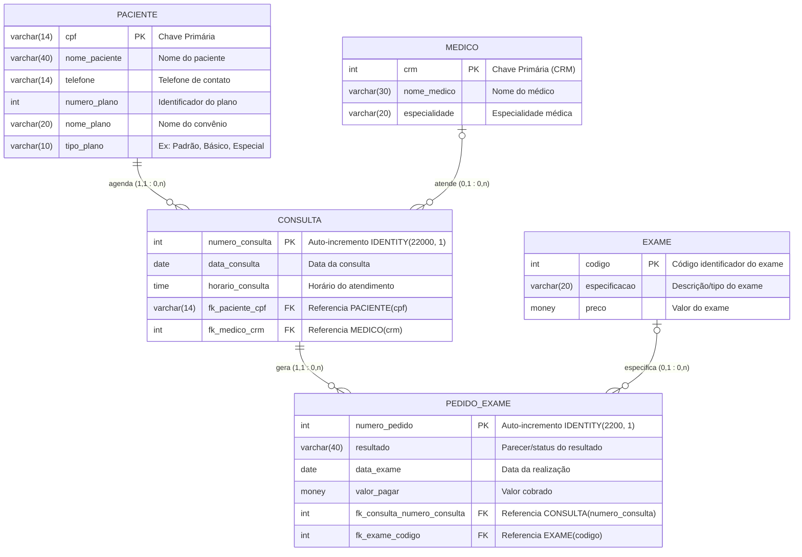

# Atividade 1 - Criar Modelo Lógico e Tabelas, e Aplicar Comandos DML do SQL

**Curso / Unidade Curricular:** UC13 - Banco de Dados  
**Turma:** CTMSP_DPE_QO_FULLST_252T01_BDADO_QUA.568.004  
**Situação-Problema:** Banco de Dados para Clínica Médica  

---

## 📌 Referências e Vídeo da Atividade
- **Vídeo Tutorial da Aula:** [Criação e manipulação de banco de dados (YouTube)](https://www.youtube.com/watch?v=XCFw7TtedS8)
- **Canal de Apoio:** [Canal no YouTube](https://www.youtube-nocookie.com/channel/UC4fCiXPjL_8efQYxyD9GgDg)

---

## 🎯 Objetivo da Atividade
1. **Estruturar o Modelo Lógico (DER):** Modelar as entidades, atributos, tipos de dados, chaves primárias (PK), chaves estrangeiras (FK) e cardinalidades para a Clínica Médica.
2. **Definição de Dados (DDL):** Desenvolver o script de criação do banco de dados `clinica_medica` e suas tabelas no Microsoft SQL Server, aplicando integridade referencial com `ON DELETE CASCADE`.
3. **Manipulação de Dados (DML):** Aplicar comandos de inserção (`INSERT INTO`), consulta (`SELECT`), atualização (`UPDATE`) e exclusão (`DELETE`) com uso criterioso da cláusula `WHERE`.

---

## 📊 1. Modelo Lógico (Diagrama Entidade-Relacionamento - DER)



---

## 📋 2. Dicionário de Dados e Cardinalidades

| Tabela | Chave Primária | Chaves Estrangeiras | Regra e Cardinalidade |
| :--- | :--- | :--- | :--- |
| **`paciente`** | `cpf` (VARCHAR 14) | - | **(1,1) para (0,n)** com `consulta`. Um paciente pode realizar várias consultas, mas uma consulta pertence a apenas 1 paciente. |
| **`medico`** | `crm` (INT) | - | **(0,1) para (0,n)** com `consulta`. Um médico pode atender diversas consultas. Uma consulta é atendida por 1 médico. |
| **`consulta`** | `numero_consulta` (INT IDENTITY) | `fk_paciente_cpf`, `fk_medico_crm` | **(1,1) para (0,n)** com `pedido_exame`. Uma consulta pode gerar pedidos de exame vinculados. |
| **`exame`** | `codigo` (INT) | - | **(0,1) para (0,n)** com `pedido_exame`. Um exame pode ser solicitado em vários pedidos. |
| **`pedido_exame`** | `numero_pedido` (INT IDENTITY) | `fk_consulta_numero_consulta`, `fk_exame_codigo` | Cada pedido referencia exatamente 1 consulta e 1 tipo de exame. |

---

## 🛠️ 3. Scripts SQL

### 3.1 DDL - Criação do Banco, Tabelas e Constraints

```sql
-- Criação da Base de Dados
CREATE DATABASE clinica_medica;
GO

USE clinica_medica;
GO

-- Tabelas Independentes (sem chave estrangeira)
CREATE TABLE paciente (
    cpf VARCHAR(14) PRIMARY KEY,
    nome_paciente VARCHAR(40),
    telefone VARCHAR(14),
    numero_plano INT,
    nome_plano VARCHAR(20),
    tipo_plano VARCHAR(10)
);

CREATE TABLE medico (
    crm INT PRIMARY KEY,
    nome_medico VARCHAR(30),
    especialidade VARCHAR(20)
);

CREATE TABLE exame (
    codigo INT PRIMARY KEY,
    especificacao VARCHAR(20),
    preco MONEY
);

-- Tabelas Dependentes (com IDENTITY e Chaves Estrangeiras)
CREATE TABLE consulta (
    numero_consulta INT IDENTITY(22000, 1) PRIMARY KEY,
    data_consulta DATE,
    horario_consulta TIME,
    fk_paciente_cpf VARCHAR(14),
    fk_medico_crm INT
);

CREATE TABLE pedido_exame (
    numero_pedido INT IDENTITY(2200, 1) PRIMARY KEY,
    resultado VARCHAR(40), 
    data_exame DATE,
    valor_pagar MONEY,
    fk_consulta_numero_consulta INT,
    fk_exame_codigo INT
);

-- Chaves Estrangeiras com Integridade Referencial
ALTER TABLE consulta ADD CONSTRAINT FK_consulta_paciente
    FOREIGN KEY (fk_paciente_cpf)
    REFERENCES paciente (cpf)
    ON DELETE CASCADE;

ALTER TABLE consulta ADD CONSTRAINT FK_consulta_medico
    FOREIGN KEY (fk_medico_crm)
    REFERENCES medico (crm)
    ON DELETE CASCADE;

ALTER TABLE pedido_exame ADD CONSTRAINT FK_pedido_exame_consulta
    FOREIGN KEY (fk_consulta_numero_consulta)
    REFERENCES consulta (numero_consulta)
    ON DELETE CASCADE;

ALTER TABLE pedido_exame ADD CONSTRAINT FK_pedido_exame_exame
    FOREIGN KEY (fk_exame_codigo)
    REFERENCES exame (codigo);
GO
```

---

### 3.2 DML - Carga Inicial de Dados (`INSERT INTO`)

```sql
-- Carga da tabela paciente
INSERT INTO paciente VALUES('012.345.678-90', 'Leonardo Ribeiro', '(11)91234-5678', 123456, 'Inovamed', 'Padrão');
INSERT INTO paciente VALUES('123.456.789-12', 'Bruna Alvez', '(15)92345-6789', 234567, 'Ultramed', 'Básico');
INSERT INTO paciente VALUES('234.567.890-23', 'Gilberto Barros', '(11)94567-8901', 345678, 'Inovamed', 'Especial');
INSERT INTO paciente VALUES('345.678.901-45', 'Maria Pereira', '(12)95678-9012', 456789, 'Ultramed', 'Padrão');
INSERT INTO paciente VALUES('456.789.012-34', 'Arnaldo Coelho', '(19)96789-0123', 567890, 'Inovamed', 'Especial');

-- Carga da tabela medico
INSERT INTO medico VALUES(102030, 'Agildo Nunes', 'Cardiologia');
INSERT INTO medico VALUES(203040, 'Márcia Alvez', 'Gastrologia');
INSERT INTO medico VALUES(304050, 'Roberto Gusmão', 'Neurologia');
INSERT INTO medico VALUES(405060, 'Edna Cardoso', 'Ortopedia');
INSERT INTO medico VALUES(506070, 'Ricardo Souza', 'Otorrinolaringologia');
INSERT INTO medico VALUES(607080, 'Lúcia Marques', 'Pediatria');
INSERT INTO medico VALUES(708090, 'Beatriz Lucena', 'Oncologia');

-- Carga da tabela exame
INSERT INTO exame VALUES(10020, 'Hemograma', 100.00);
INSERT INTO exame VALUES(10030, 'Tomografia', 250.00);
INSERT INTO exame VALUES(10040, 'Ultrassonografia', 550.00);
INSERT INTO exame VALUES(10050, 'Ressonância', 800.00);
INSERT INTO exame VALUES(10060, 'Radiografia', 70.00);
INSERT INTO exame VALUES(10070, 'Mamografia', 150.00);
INSERT INTO exame VALUES(10080, 'Endoscopia', 300.00);
INSERT INTO exame VALUES(10090, 'Colonoscopia', 300.00);
INSERT INTO exame VALUES(10100, 'Eletrocardiograma', 50.00);
INSERT INTO exame VALUES(10110, 'Ecocardiograma', 120.00);
INSERT INTO exame VALUES(10120, 'Audiometria', 65.00);

-- Carga da tabela consulta (campos IDENTITY gerados automaticamente)
INSERT INTO consulta VALUES('2022/12/12', '14:30', '012.345.678-90', 102030);
INSERT INTO consulta VALUES('2022/12/13', '08:30', '123.456.789-12', 203040);
INSERT INTO consulta VALUES('2022/12/13', '11:00', '123.456.789-12', 304050);
INSERT INTO consulta VALUES('2022/12/14', '10:00', '234.567.890-23', 203040);
INSERT INTO consulta VALUES('2022/12/15', '15:00', '345.678.901-45', 405060);
INSERT INTO consulta VALUES('2022/12/16', '10:00', '123.456.789-12', 506070);
INSERT INTO consulta VALUES('2022/12/19', '16:45', '234.567.890-23', 102030);
INSERT INTO consulta VALUES('2022/12/19', '18:00', '345.678.901-45', 607080);
INSERT INTO consulta VALUES('2022/12/20', '09:00', '012.345.678-90', 304050);
INSERT INTO consulta VALUES('2022/12/20', '14:20', '123.456.789-12', 102030);

-- Carga da tabela pedido_exame (campos IDENTITY gerados automaticamente)
INSERT INTO pedido_exame VALUES('Normal', '2022/12/15', 0.00, 22000, 10040);
INSERT INTO pedido_exame VALUES('', '2022/12/19', 0.00, 22000, 10100);
INSERT INTO pedido_exame VALUES('', '2022/12/16', 0.00, 22001, 10080);
INSERT INTO pedido_exame VALUES('Normal', '2022/12/15', 0.00, 22002, 10050);
INSERT INTO pedido_exame VALUES('Inconsistente', '2022/12/16', 0.00, 22003, 10080);
INSERT INTO pedido_exame VALUES('', '2022/12/17', 0.00, 22004, 10060);
INSERT INTO pedido_exame VALUES('Normal', '2022/12/21', 0.00, 22007, 10020);
INSERT INTO pedido_exame VALUES('', '2022/12/22', 0.00, 22008, 10030);
INSERT INTO pedido_exame VALUES('', '2022/12/22', 0.00, 22008, 10050);
```

---

### 3.3 DML - Atualização (`UPDATE`) com `WHERE`

```sql
-- Atualiza nome de paciente específico pelo CPF
UPDATE paciente 
SET nome_paciente = 'Aguinaldo Coelho' 
WHERE cpf = '456.789.012-34';

-- Atualiza especialidade do médico pelo CRM
UPDATE medico 
SET especialidade = 'Ginecologia' 
WHERE crm = 708090;

-- Atualiza preço do exame pelo Código
UPDATE exame 
SET preco = 135.00 
WHERE codigo = 10110;
```

---

### 3.4 DML - Exclusão (`DELETE`) com `WHERE`

```sql
-- Exclusão pontual de paciente
DELETE FROM paciente 
WHERE cpf = '456.789.012-34';

-- Exclusão pontual de médico
DELETE FROM medico 
WHERE crm = 708090;
```

---

## 💡 4. Conceitos-Chave e Melhores Práticas

1. **Importância do MER / DER:** Antecipa o planejamento das entidades, atributos e integridade antes do banco físico, evitando retrabalho estrutural e redundâncias.
2. **Cláusula `WHERE` Obrigatória:** Executar `UPDATE` ou `DELETE` sem `WHERE` altera ou remove indiscriminadamente todos os registros da tabela.
3. **Chaves Primárias e Integridade:** As PKs garantem a unicidade dos dados; as FKs com `ON DELETE CASCADE` impedem registros órfãos, mantendo o banco consistente.
